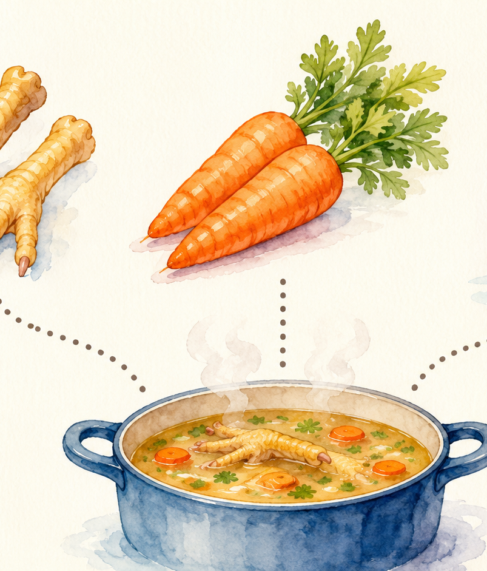
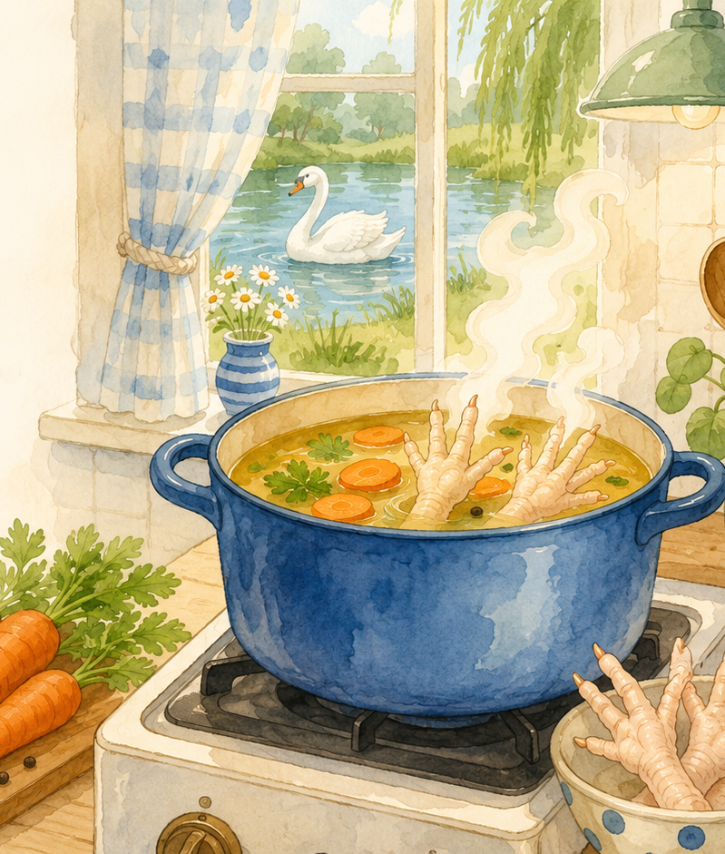
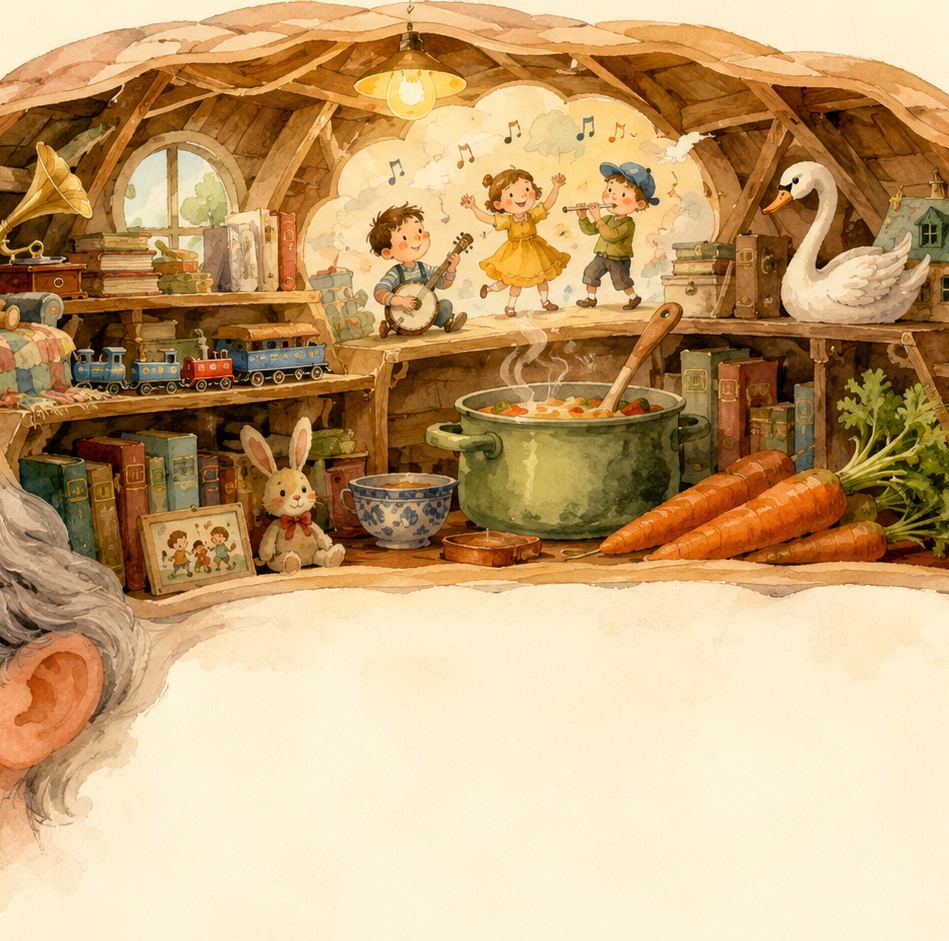
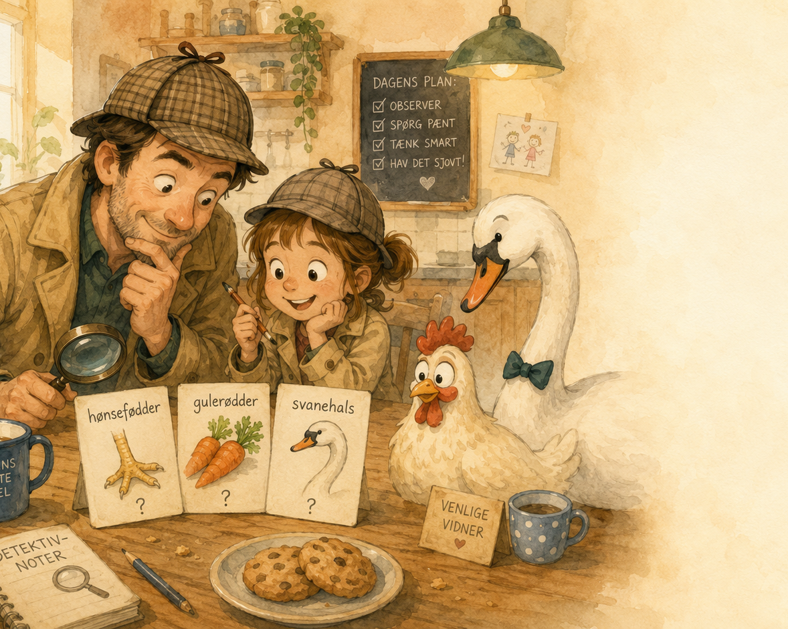
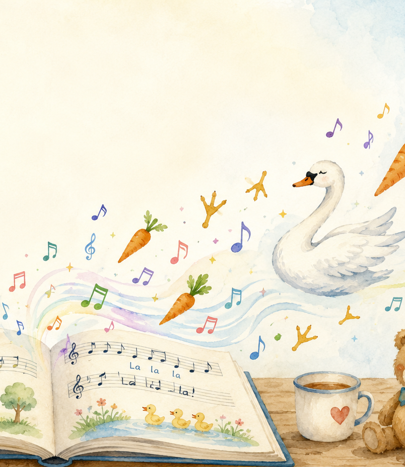

 

## Hønsefødder, gulerødder og en svanehals {.full-bg-right background-image="assets/uncle_right.png"}

:::::: title-block
::: subtitle
En lille præsentation om, hvorfor en onkel på omkring “stadig relativt ung” kan høre en børnesang, når der tales om suppe.
:::

::: {style="height: 260px"}
:::

::: kicker
Til Dagmar — med mildt pædagogisk onkelgaranti
:::
::::::

::: notes
Forklar, at præsentationen er en “manual” til en bestemt onkel-joke.
:::

## Scene 1: billedet med de frosne hønsefødder

::: subtitle
Før joken kan forstås, skal vi lige samle sporene.
:::

::::: two-col
::: {}
**Samtalen gik nogenlunde sådan:**

- Et billede af frosne hønsefødder lander i chatten.
- Dagmar og onkel er enige: det ser ikke umiddelbart lækkert ud.
- Onkel siger alligevel: “Det kunne nok give en god suppe.”
- Og så kommer den mystiske tilføjelse: “med gulerødder og en svanehals.”
:::

::: {}

:::
:::::

::: notes
Start med den konkrete chat: billedet, smagen og suppeidéen.
:::

## Scene 2: suppedelen er faktisk næsten fornuftig

::: subtitle
Der er en lille kerne af madlogik under alt onkelvrøvlet.
:::

:::::::: two-col
:::::: {}
::: ingredient
<h3>Hønsefødder</h3>

kan bruges til fond/suppe, fordi skind, sener og brusk giver fylde i væsken.

:::

::: ingredient
<h3>Gulerødder</h3>

giver sødme, farve og den slags pænhed, der får suppe til at se mindre “frossen fod”-agtig ud.

:::

::: ingredient
<h3 class="blue">

Svanenhalsen

</h3>

er dér, hvor opskriften forlader køkkenet og går direkte ind i børnesangsafdelingen.

:::
::::::

::: {.img-cell}

:::
::::::::

::: notes
Gør klart, at hønsefødder faktisk kan give fylde i suppe. Gulerødder er klassisk suppegrønt.
:::

## Scene 3: den skjulte børnesang {.full-bg-right .scene-song-bg background-image="assets/songbook.png"}

:::: {.scene3-text}
::: subtitle
Onkelens hjerne hørte ikke kun “mad”. Den hørte også en gammel remse.
:::

Mange voksne kender børnesangen/remse-linjen:

“Hønsefødder og gulerødder og halsen af en svane …”

Den er ikke berømt for dyb mening. Den er berømt for rytme, fjollede billeder og ord, der sætter sig fast.
::::

::: notes
Syng evt. kun den korte linje, ikke hele sangen. Pointen er genkendelsen.
:::

## Jokens motor: når mad møder remse

::: subtitle
Det er ikke én joke. Det er fire små hjul, der kører på samme tid.
:::

:::::::::: flow
::: {.box .orange}
1 Hønsefødder
:::

::: arrow
→
:::

::: {.box .blue}
2 Gammel sang tænder i hjernen
:::

::: arrow
→
:::

::: {.box .green}
3 Suppe gør det til “opskrift”
:::

::: arrow
→
:::

::: {.box .gold}
4 Svanehals = absurd finish
:::
::::::::::

Det sjove er altså overgangen: En rigtig mulig suppeidé bliver koblet til en vrøvlesang, som om sangen var en seriøs kogebog.

::: notes
Vis, at joken er en kædereaktion, ikke bare et tilfældigt ord.
:::

## Hvorfor gør onkler den slags?

::: subtitle
Fordi voksenhjerner er fyldt med gamle melodier, reklamer, citater og andet nyttigt rod.
:::

::::: two-col
::: {}
- Et usædvanligt ord kan åbne en hel hukommelsesskuffe.
- “Hønsefødder” ligger sjældent alene. For mange ligger det sammen med “gulerødder”.
- Når der så også tales om suppe, begynder onkelhjernen at lave “falsk opskrift”.
- Resultatet er en joke, der føles elegant inde i onklens hoved — og lidt som kode uden dokumentation for alle andre.
:::

::: {}

:::
:::::

::: notes
Brug “hukommelsesskuffe” som billede: rare ord åbner gamle mapper.
:::

## Hvorfor fangede Dagmar den ikke?

::: subtitle
Fordi hun manglede den skjulte fil i hukommelsen: sangen.
:::

::::: {.two-col .reverse}
::: {}

:::

::: {}
**Jokes med referencer virker sådan:**

- Kender man referencen: “Aha!”
- Kender man den ikke: “Hvorfor snakker du om svaner?”
- Det betyder ikke, at joken er dårlig. Det betyder bare, at adgangskoden ikke var delt.

I dette tilfælde var adgangskoden: en gammel børnesang.

:::
:::::

::: notes
Understreg, at Dagmar ikke “missede” noget dumt; hun manglede bare referencen.
:::

## Svanehals-tricket

::: subtitle
Her bliver ordspillet næsten synligt med lup.
:::

::::: two-col
::: {}
I sangen er det **“halsen af en svane”** — en mærkelig, næsten eventyrlig ingrediens.

I samtalen blev det til **“svanehals”** — som lyder kortere og mere opskriftsagtigt, men stadig er helt fjollet.

Pointen er netop, at onkel tager en vrøvlelinje og lader som om, den er kulinarisk visdom.

Anbefalet køkkenpraksis: brug hønsefødder og gulerødder. Lad svanen svømme videre.

:::

::: {}

:::
:::::

::: notes
Skeln mellem sangens “halsen af en svane” og onkelens “svanehals”.
:::

## Sådan afkoder man en onkel-joke

::: subtitle
En praktisk metode til næste gang nogen siger noget, der lyder som fejl i sproget.
:::

:::::::: steps
::: {.box .orange}
Trin 1 Find det mærkelige ord
:::

::: arrow
→
:::

::: {.box .blue}
Trin 2 Spørg: “Er det fra en sang, film eller reklame?”
:::

::: arrow
→
:::

::: {.box .green}
Trin 3 Tjek om onklen ser meget tilfreds ud
:::
::::::::

Hvis svaret på trin 2 er “ja”, er det sandsynligvis ikke køkkenrådgivning. Det er kulturarv i sokker.

Bonus: Man må gerne bede onklen synge kilden. Det gør ham enten glad eller meget stille.

::: notes
Giv Dagmar en metode til næste gang. Det er også en joke på onkler.
:::

## Konklusion {.full-bg-right background-image="assets/uncle_full.png"}

:::: {style="width: 600px; padding-top: 30px;"}

::: subtitle
Joken virker sådan:
:::

frosne hønsefødder + rigtig suppeidé + gammel børnesang + én alt for selvsikker onkel

= en reference-joke, der først skal forklares — og som derfor næsten automatisk bliver mere onkelagtig.

Suppen kan måske blive god. Referencen skulle bare koge lidt længere.

::::

::: notes
Slut varmt: joken er forklaret, og svanen slipper fri.
:::