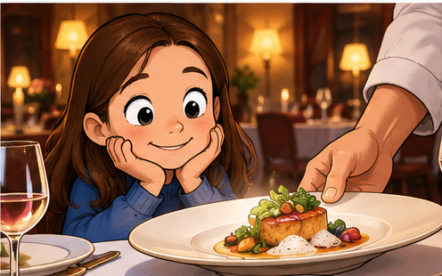
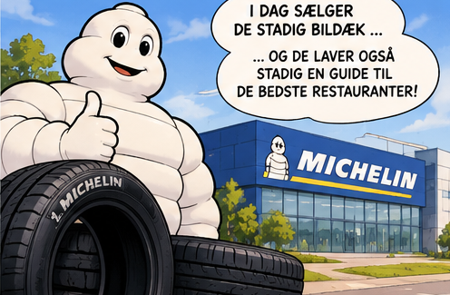
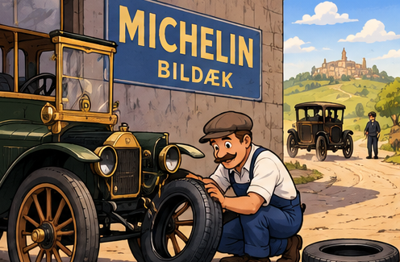
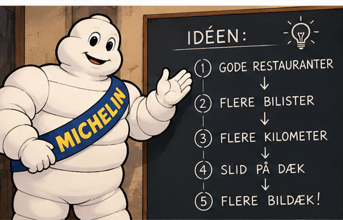
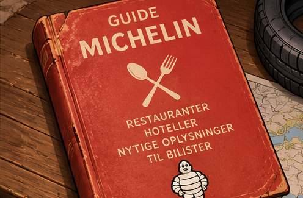
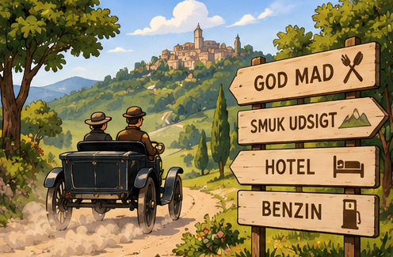
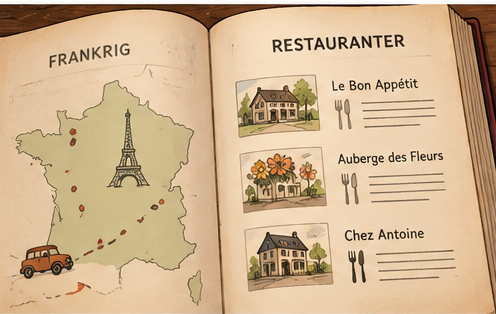
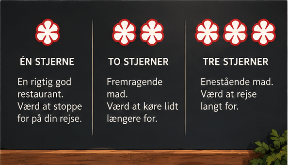

# Anbefalet af et **bildækfirma?!** {.hero}

{.hero-image alt="En ung restaurantgæst får serveret et smukt anrettet måltid"}

**Topforvirrende - hvad har det med mad i Sverige at gøre?**

::: {.notes}
Begynd med det, vi allerede har fortalt Dagmar: Vi har spist på restauranter anbefalet af et firma, der laver bildæk. Spørg, hvad et bildækfirma mon ved om god mad. Lad gerne påstanden lyde lidt som en onkeljoke.
:::

---

# Vent … hvad har **dæk** med **mad** at gøre?

:::: {.columns}
::: {.column width="52%"}
{.picture alt="Michelin-manden foran et moderne Michelin-firma"}
:::
::: {.column width="48%"}
**Michelin** laver dæk.

**Michelin** anbefaler restauranter.

Det er **det samme firma**.
:::
::::

::: {.notes}
Man spiser jo ikke dæk. Og Michelin-stjerner er ikke en pris for gode bildæk. Forklar, at Michelin både er en dækproducent og udgiver af den berømte restaurantguide.
:::

---

# Spol tilbage til **1889**

:::: {.columns}
::: {.column width="59%"}
{.picture alt="En tidlig bil får skiftet dæk på et gammeldags værksted"}
:::
::: {.column width="41%"}
Biler var **nye og sjældne**.

Ingen GPS. Få værksteder.

To brødre begyndte at lave dæk.
:::
::::

::: {.notes}
André og Édouard Michelin grundlagde Michelin-firmaet i Frankrig i 1889. Biler var dengang en ny og sjælden opfindelse, og lange ture var besværlige. Bed Dagmar forestille sig at køre uden GPS og uden at kende steder med benzin, værksted eller overnatning.
:::

---

# Problemet: Folk **kørte for lidt**

Dæk slides, når biler kører.

Mere kørsel → mere slid → nye dæk →  flere penge

**Hvordan får man folk til at køre mere?**

::: {.notes}
Når bilen kører, slides dækkene langsomt. Michelin havde en oplagt kommerciel interesse i, at flere mennesker tog på bilture. Ikke sådan, at ét restaurantbesøg ødelægger dækkene, men på længere sigt skaber mere bilkørsel behov for flere dæk.
:::

---

# En **genialt snedig** idé

{.wide-picture alt="Michelin-manden viser idéen fra gode restauranter via flere bilister til flere bildæk"}

**Giv folk en god grund til at tage af sted!**

::: {.notes}
Michelin indså, at man kunne fremme bilkørsel ved at gøre bilture både nemmere og mere attraktive. En restaurant kunne være et mål i sig selv, og en god rejseguide kunne fjerne noget af besværet ved at køre langt.
:::

---

# **1900:** En gratis bog til bilister

:::: {.columns}
::: {.column width="54%"}
{.picture alt="En gammel rød Michelin-guide ligger oven på et kort"}
:::
::: {.column width="46%"}
I bogen stod der, hvor man fandt:

- benzin
- værksteder
- hoteller
- **steder at spise!**
:::
::::

::: {.notes}
Den første Michelin-guide kom i 1900 og var gratis. Den var ikke først og fremmest en guide til fine restauranter, men en praktisk rejsebog for bilister. Den indeholdt nyttig information, blandt andet om tankning, reparation, overnatning og mad. Man kan kalde den en slags Google Maps på papir.
:::

---

# Tænk, hvis du blev **sulten** på turen …

{.wide-picture alt="En tidlig bil kører på landet forbi skilte mod mad, udsigt, hotel og benzin"}

**»Den restaurant ser god ud. Vi kører derhen!«**

::: {.notes}
Hvis man læste om en god restaurant et stykke væk, fik man en grund til at køre en tur. Guiden hjalp også med at finde benzin og et sted at sove. Flere og længere køreture var til fordel for et firma, som solgte dæk.
:::

---

# Hvorfor gav de bogen væk **gratis**?

**»Køb vores dæk!«**

*eller …*

**»Her er en nyttig guide til en god ferie!«**

Hvilket firma ville du huske?

::: {.notes}
Lad Dagmar vælge. Michelin var et tidligt eksempel på markedsføring gennem noget, der var nyttigt i sig selv. I 1920 begyndte guiden at koste penge. Michelin fortæller en anekdote om, at André så gratis eksemplarer brugt til at støtte et arbejdsbord; historien kommer fra firmaet selv og er ikke nødvendig for forklaringen.
:::

---

# Så begyndte de at **bedømme maden**

:::: {.columns}
::: {.column width="55%"}
{.picture alt="En opslået Michelin-guide med kort og restaurantanbefalinger"}
:::
::: {.column width="45%"}
Restauranterne blev vigtigere.

Michelin sendte **anonyme inspektører** ud.

De smagte på maden og vurderede den.
:::
::::

::: {.notes}
Med tiden blev vurderinger af spisestederne en central del af guiden. Michelin-inspektører besøger restauranter anonymt for at vurdere kvaliteten som almindelige gæster. De bedømmer især selve maden: råvarer, smag, teknik, kokkens særpræg og ensartethed.
:::

---

# Og så kom **stjernerne**

<strong>1926</strong> Første stjerner &nbsp; · &nbsp; <strong>1931</strong> Systemet med 1, 2 og 3 stjerner

{.stars-image alt="Tavle med én, to og tre Michelin-stjerner og forklaringer på dansk"}

::: {.notes}
I 1926 begyndte guiden at give én stjerne til særlig gode restauranter. I 1931 kom tretrins-systemet. På billedet står de rejserelaterede betydninger. Læg mærke til, at alle definitionerne stadig handler om at rejse: et stop, en omvej eller en særlig rejse. Det er arven fra bilguiden.
:::

---

# Ét stop. En omvej. **En hel rejse.**

★
<strong>Én stjerne</strong>Værd at stoppe for

★★
<strong>To stjerner</strong>Værd at køre en omvej for

★★★
<strong>Tre stjerner</strong>Værd at rejse efter

**Det lyder jo stadig som en guide til bilister!**

::: {.notes}
De officielle Michelin-definitioner svarer omtrent til: en stjerne, mad af høj kvalitet, værd at stoppe for; to stjerner, fremragende køkken, værd at køre en omvej for; tre stjerner, enestående køkken, værd at rejse efter. En stjerne tilhører restauranten, ikke kokken som privatperson, og vurderingen kan ændres fra år til år.
:::

---

# Stjerner på **restaurantens dør**

{.portrait-picture alt="En pige ser op på et rødt Michelin-skilt foran en restaurant"}

**Nu rejste folk efter maden – ikke bare for turens skyld.**

::: {.notes}
Over tid udviklede den praktiske bilguide sig til en internationalt berømt restaurantguide. Michelin anbefaler også restauranter uden stjerner. En stjerne er en særlig udmærkelse, ikke en forudsætning for at være omtalt i guiden.
:::

---

# Et lille ekstra mysterium …

{.wide-picture alt="Michelin-manden står ved dæk foran en Michelin-bygning"}

**Michelin-manden hedder Bibendum.**

Han er lavet af … **dæk!**

::: {.notes}
Michelin-manden, Bibendum, stammer fra 1898, før den første guide. Han er en af verdens ældste reklamefigurer. Figuren er hvid, selvom moderne bildæk typisk er sorte.
:::

---

# Tilbage til vores **middag**

:::: {.columns}
::: {.column width="55%"}
{.picture alt="En ung gæst får serveret en elegant ret på en restaurant"}
:::
::: {.column width="45%"}
Vi spiste på en restaurant …

… som blev anbefalet af **Michelin** …

… som laver **bildæk**!
:::
::::

::: {.notes}
Vend tilbage til den konkrete historie, Dagmar allerede har hørt fra os. Det, der først lød som en dårlig onkeljoke, er bogstaveligt talt rigtigt. Michelins dækvirksomhed eksisterer fortsat sideløbende med restaurantguiden. Hvis vi sagde 'anbefalet' og ikke 'med stjerner', skal vi holde fast i den forskel: en anbefalet restaurant behøver ikke have en stjerne.
:::

---

# Så … **hvem fandt på det?**

Et **dækfirma**, der gerne ville have folk til at **køre mere**.

**Og idéen virkede så godt, at vi stadig taler om den over 125 år senere.**

::: {.notes}
Spørg Dagmar: Kan du forklare, hvordan gode restauranter skulle hjælpe et firma med at sælge dæk? Hjælp med kæden: guide til gode steder, lyst til bilture, flere kilometer, dæk slides og udskiftes.
:::

---

# Hvor ved vi det fra? {.references}

- [Michelin-guidens officielle historie](https://guide.michelin.com/us/en/about-us)
- [Historien om Michelin-guiden](https://www.michelin.co.uk/blog/articles/history-of-the-michelin-guide)
- [Hvad Michelin-stjernerne betyder](https://intercom.help/michelin-guide-apps/en/articles/8618608-what-are-the-michelin-guide-distinctions)
- [Michelin-mandens historie](https://www.michelin.dk/afsloring-af-michelinmandens-oprindelse-den-ikoniske-maskots-historie)

::: {.notes}
Årstal og den grundlæggende fortælling bygger på Michelinguidens og dækfirmaets egne historiske gennemgange. Illustrationerne er tegninger, ikke historiske fotografier.
:::
